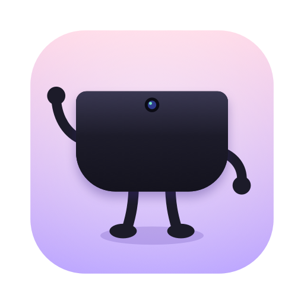
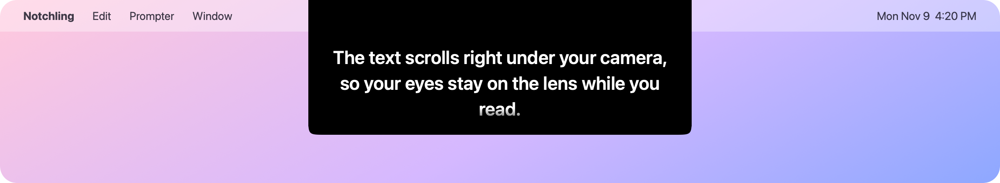
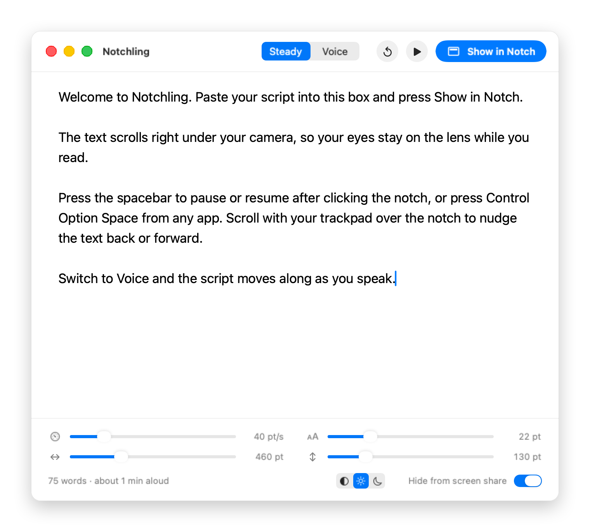

<div align="center">
  
  <h1>Notchling</h1>
  <p>A tiny teleprompter that lives in your Mac's notch, right under the camera,<br>so your eyes stay on the lens while you read.</p>
  <br>
  
</div>

<br>

### Features

- **Paste and go.** One text box for your script. It's saved between launches.
- **Lives in the notch.** A black panel that blends into the notch and scrolls your script just below the camera. Displays without a notch get it centered under the menu bar.
- **Readable text.** Adjustable text size (14–48 pt), panel width, and height.
- **Steady scrolling** at a speed you set (5–200 pt/s).
- **Voice mode.** Optional mode that keeps your place in the script as you speak, using on-device speech recognition. Lines you've already read dim out.
- **Pause anywhere.** Spacebar on the notch, or <kbd>⌃</kbd> <kbd>⌥</kbd> <kbd>Space</kbd> from any app.
- **Scroll to nudge.** Use your trackpad over the notch to move back or ahead, even while it's playing.
- **Hidden from screen sharing** by default, so viewers don't see your notes.

<br>

<div align="center">
  <picture>
    <source media="(prefers-color-scheme: dark)" srcset="assets/editor-dark.png">
    
  </picture>
</div>

<br>

### Controls

| Key | Action |
| :-- | :-- |
| <kbd>⌘</kbd> <kbd>↩</kbd> | Show / hide the notch prompter |
| <kbd>Space</kbd> | Pause / resume (click the notch first) |
| <kbd>⌃</kbd> <kbd>⌥</kbd> <kbd>Space</kbd> | Pause / resume from any app |
| Trackpad scroll | Nudge the text back or forward |
| <kbd>↑</kbd> / <kbd>↓</kbd> | Faster / slower |
| <kbd>R</kbd> | Restart from the top |
| <kbd>Esc</kbd> | Hide the prompter |

### Install

Notchling builds from source with the Xcode command line tools (no Xcode project needed).

```bash
git clone https://github.com/ztothewang/notchling.git
cd notchling
./build.sh --install   # builds and copies Notchling.app to /Applications
```

Use `./build.sh` alone to build into `build/Notchling.app` without installing.

Requires macOS 14 Sonoma or later. Install the command line tools with `xcode-select --install` if you don't have them.

### Permissions and privacy

Notchling asks for **Microphone** and **Speech Recognition** access on first launch. Both are used only by Voice mode. Speech is recognized on-device when your Mac supports it. Nothing is recorded, stored, or sent anywhere, and there are no accounts or analytics.

You only grant these once. (If you change the code and rebuild, macOS treats the new build as a new app and asks again.)

<details>
<summary><b>Project layout</b></summary>

<br>

```
Sources/
  main.swift             App delegate, menus, editor window
  EditorView.swift       Script editor and settings (SwiftUI)
  NotchController.swift  Notch panel placement, global hotkey
  PrompterView.swift     Text rendering, scrolling, voice following
  SpeechFollower.swift   Microphone + speech recognition
  Model.swift            Settings and script, saved to UserDefaults
scripts/make_icon.swift  Draws the app icon
scripts/screenshots.sh   Regenerates the README screenshots
build.sh                 Compiles and bundles Notchling.app
```

</details>

### License

MIT. See [LICENSE](LICENSE).
